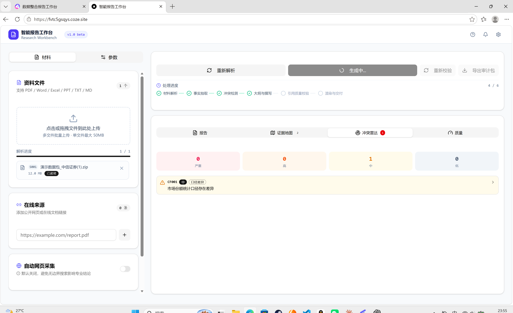
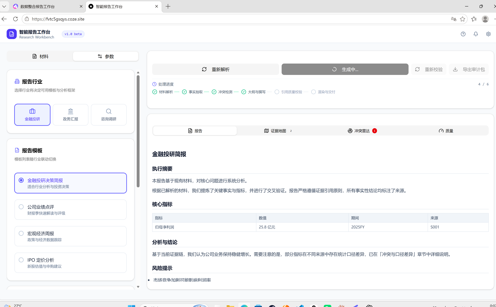
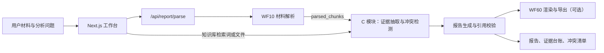

# EvidenceOS

### 可追溯的智能报告工作台

**从多源材料到证据台账、冲突清单和可审计报告。**

EvidenceOS 是一个面向金融研究、政策汇报和咨询分析场景的报告工作台原型。它把材料解析、事实抽取、冲突识别、报告生成与交付串成一条可观察的流程，让报告中的关键判断尽可能回到来源和原文。

> **项目状态：Beta / 研究原型。** Web 工作台和 API 接入层已提交；真实解析与生成依赖单独部署的 Coze 工作流。未配置服务时，应用会进入演示模式。当前仓库没有发布可复现的准确率基准，也没有包含可导入的 Coze 工作流定义。

---

## 产品预览





---

## 为什么做 EvidenceOS

传统的“上传材料 → 让模型写报告”很难回答几个关键问题：

- 结论来自哪份材料、哪一页、哪段原文？
- 两份材料的数值不同，是统计范围不同，还是确实互相矛盾？
- 报告引用是否能回到证据台账，未解决的风险是否被清楚标出？

EvidenceOS 将**证据可追溯**与**冲突可解释**作为报告链路的核心约束。目标不是让文本看起来更长，而是让使用者能检查报告依据、发现资料缺口并判断哪些结论仍需人工核验。

## 核心能力

- **多源材料入口**：支持上传文件与在线来源；解析工作流返回来源清单和文本切片。
- **结构化事实台账**：围绕主体、指标、数值、单位、期间、范围、原文和定位组织证据。
- **分层冲突识别**：将硬规则检测与语义判断拆开，保留冲突所关联的证据。
- **流式任务反馈**：后端以 SSE 传递进度、证据、冲突、正文和最终结果。
- **行业化报告工作台**：提供金融投研、政务汇报和咨询调研模板配置，以及报告、证据地图、冲突雷达和质量视图。
- **审计包导出**：将报告正文、证据台账、冲突清单、来源状态和完整性检查结果打包为可下载 JSON。

## 架构一览

`WF10`、`C 模块` 和 `WF60` 是外部工作流服务，通过环境变量配置。Web 应用负责接收用户输入、转发任务、翻译 SSE 事件并呈现结果。



### 你负责的模块：证据抽取与冲突检测

C 模块承接解析切片或知识库检索结果，产出可供报告生成使用的结构化证据与冲突结果。流程图中的职责边界如下：

1. **数据入口路由**：在文档切片与知识库检索结果之间选择输入路径，并汇入统一处理链路。
2. **文档切片**：将长材料整理为可处理片段。切片粒度、重叠策略以及页码/段落定位应以实际 Coze 节点配置为准。
3. **事实抽取**：从片段中提取事实，并绑定来源与原文。项目的数据契约还定义了主体、谓词、数值、单位、期间、范围、定位和置信度等字段。
4. **归一化与去重**：统一可比较字段并合并重复事实；去重时应保留各来源的出处，避免丢失证据链。
5. **硬冲突规则检测**：在主体、指标、期间和统计范围可比时，识别数值或口径差异。
6. **语义冲突判定**：补充规则难以覆盖的文本矛盾判断，并说明涉及的事实与判定理由。
7. **冲突合并与统计**：合并重复冲突，关联证据 ID，汇总类型和风险等级后输出。

**证据台账是模块输出的关键接口。** 每条事实应尽可能包含 `evidence_id`、`source_id`、`subject`、`predicate`、`value`、`unit`、`period`、`scope`、`quote`、`locator` 和 `confidence`。冲突清单应关联 `evidence_ids`，让用户可以从“存在差异”继续追到差异双方的原始依据。

> 上述流程节点来自项目中的工作流图与数据契约说明。具体提示词、规则阈值、模型配置和节点级评测尚未随仓库发布；README 不将这些未公开配置表述为已经验证的实现细节。

## 你负责的模块：设计与评测

节点职责、证据字段契约、归一化边界、冲突判定策略和建议评测集整理在 [证据流水线设计与评测计划](docs/evidence-pipeline.md)。文档明确区分仓库已确认的接口与仍需在 Coze 工作流中实现和验证的设计建议，便于把流程图进一步变成可复现、可评测的工程模块。

## 技术栈

| 层 | 技术 |
|---|---|
| Web 应用 | Next.js App Router、React、TypeScript |
| UI | Tailwind CSS、shadcn/ui、Radix UI |
| 流式接口 | Server-Sent Events（SSE） |
| 工作流 | Coze 工作流 HTTP 接口；WF10 / C 模块 / WF60 独立配置 |
| 文件对象存储 | Coze SDK S3Storage 适配层（可选） |
| 包管理 | pnpm |

## 本地运行

### 环境要求

- Node.js 22 或更高版本（pnpm 11 要求）
- pnpm 11.25

### 启动

```bash
git clone https://github.com/Echo-cln/coze.git
cd coze
npm install --global pnpm@11.25.0
pnpm install --frozen-lockfile
pnpm dev
```

首次运行前，从模板创建本地环境文件：

```powershell
Copy-Item .env.example .env.local
```

macOS / Linux 可使用 `cp .env.example .env.local`。

运行安全回归：

```bash
pnpm test:security
```

浏览器访问 [http://localhost:5000](http://localhost:5000)。

未配置工作流地址时，应用会使用 mock 数据展示界面和流程交互；这适合本地预览，不代表真实材料已被解析或评估。要运行真实链路，请在 `.env.local` 配置已部署的工作流端点和对应凭证。

### 生产构建与启动

```bash
pnpm build
```

Linux / macOS 启动：

```bash
COZE_PROJECT_ENV=PROD PORT=5000 pnpm start
```

Windows PowerShell 启动：

```powershell
$env:COZE_PROJECT_ENV="PROD"
$env:PORT="5000"
pnpm start
```

自定义运行端口时同步设置 `PORT`。部署平台需将应用绑定到容器可访问的网络接口，并在平台密钥管理中配置工作流凭证；不要将 `.env.local` 或密钥写入镜像。

## 工作流配置

| 变量 | 用途 |
|---|---|
| `WF10_BASE_URL` | 材料解析工作流服务地址 |
| `WF10_API_TOKEN` | WF10 服务凭证（服务要求时配置） |
| `C_MODULE_BASE_URL` | 证据抽取与冲突检测服务地址 |
| `C_MODULE_API_TOKEN` | C 模块服务凭证（服务要求时配置） |
| `WF60_BASE_URL` | 报告渲染与导出服务地址 |
| `WF60_API_TOKEN` | WF60 服务凭证（服务要求时配置） |
| `COZE_BUCKET_ENDPOINT_URL` | 文件转存使用的对象存储端点 |
| `COZE_BUCKET_NAME` | 文件转存使用的存储桶名称 |
| `COZE_WORKLOAD_API_TOKEN` | Coze OpenAPI 凭证（启用相应 Coze API 功能时） |
| `COZE_WORKFLOW_ID` | Coze 工作流 ID（启用相应 Coze API 功能时） |
| `COZE_API_BASE_URL` | Coze API 地址，默认为国内站 |

完整变量模板见 [`.env.example`](.env.example)。不要将真实 Token、签名 URL 或用户材料提交到 Git。

## API 与事件流

| 路由 | 作用 |
|---|---|
| `POST /api/report/parse` | 调用 WF10 解析文件和 URL，返回来源与解析切片 |
| `POST /api/report/generate` | 调用 C 模块，生成证据、冲突和报告结果 |
| `POST /api/report/audit-pack` | 将当前任务结果生成可下载的 JSON 审计包 |

生成接口在正文生成后执行确定性的结构完整性检查：验证引用编号是否存在、必备章节是否齐全，并统计来源解析状态和正文段落引用率。它不代表事实正确率或模型效果基准。生成接口以 SSE 事件向前端推送流程状态。主要事件为 `progress`、`evidence`、`conflict`、`content`、`metrics`、`done` 和 `error`。具体输入和输出字段以 `src/app/api/report/` 下的路由实现与工作流契约为准。

## 本地验证

```bash
pnpm test:security
pnpm ts-check
pnpm lint:build
pnpm lint:style
pnpm audit --registry=https://registry.npmjs.org
pnpm build
```

GitHub Actions 会在 push 和 pull request 上运行同一组检查。

## 安全与部署边界

这个仓库包含服务端 API 和外部工作流凭证配置。真实链路上线时，请把应用放在公司 SSO、身份认证网关或可信访问代理之后；当前仓库没有内置用户认证、租户隔离、持久化任务授权或跨实例限流，不能把配置了真实 Token 的公开实例直接暴露到互联网。

目前已落实的基础防护包括：

- 报告预览先转义文本，只允许 HTTP/HTTPS 和页内锚点链接，避免模型输出把脚本注入工作台。
- API 限制 JSON 请求体为 8 MB；上传最多 20 个文件、单文件 20 MB、合计 100 MB，并校验允许的扩展名。
- 在线来源仅接受公网 HTTP/HTTPS 地址，并拒绝常见私网、回环和本机地址；工作流服务也应配置出站网络限制，抵御 DNS 解析变化和工作流侧 SSRF。
- 对外请求设有超时；错误响应不回传上游服务正文；导出接口限制请求大小并禁用缓存。
- 移除通配远程图片主机，并添加基础安全响应头。

依赖扫描使用 npm 官方审计源；本次锁文件审计结果为 **0 条已知漏洞**。审计数据库会变化，升级依赖后应重新运行 `pnpm audit`。自动化检查不等同于渗透测试，也不能证明 Coze 工作流、对象存储策略或部署网络配置安全。部署前应单独验证身份认证、存储桶访问权限、签名 URL 有效期、工作流出站访问规则与日志脱敏。不要上传真实敏感材料进行公开演示。

## 当前边界与下一步

仓库已具备可运行的工作台与工作流接入层，并在 push 和 pull request 上运行 CI：安全回归、类型检查、代码与样式 lint、依赖漏洞审计和生产构建都会自动执行。项目仍处于 Beta / 研究原型阶段，完整效果依赖尚未随仓库发布的 Coze 工作流定义，当前也没有可复现的模型效果基准。

下一阶段优先补齐：

- 将 Coze 工作流定义、节点说明和版本信息纳入可追踪的文档或可导入导出文件。
- 建立带人工标注的评测集，分别评估事实抽取、去重和冲突识别，并公布可复现的指标与样例。
- 让质量面板展示真实计算结果；未测量的指标应明确标为未知，不能用固定值替代。
- 补齐真实文件上传失败、工作流超时、空结果和 SSE 中断的端到端演示与复现步骤。
- 在确认项目授权范围后补充开源许可证和贡献指南；公开仓库本身不代表代码已授予再使用许可。
- 真实业务部署仍需接入身份认证、租户隔离和跨实例限流，并在可信访问边界后运行。

## 目录结构

```text
src/
├── app/
│   └── api/report/       # 解析、生成、审计包 API
├── components/           # 工作台与业务组件
├── hooks/                # 表单与工作流状态
├── lib/                  # 类型、存储、Coze 客户端与工具
└── server.ts             # Next.js 自定义服务入口
assets/                   # 界面截图与工作流接口资料
docs/                     # 证据流水线设计、接口契约与评测计划
tests/                    # 安全回归测试
.github/workflows/        # GitHub Actions CI
```

## 参与改进

欢迎围绕以下方向提出 Issue 或 Pull Request：可追溯事实抽取、冲突判断评测、工作流接口稳定性、失败恢复与报告可用性。提交涉及模型效果的改动时，请附上可复现输入、预期输出和评测方法。

---

**EvidenceOS · Reports you can trace back to evidence.**

